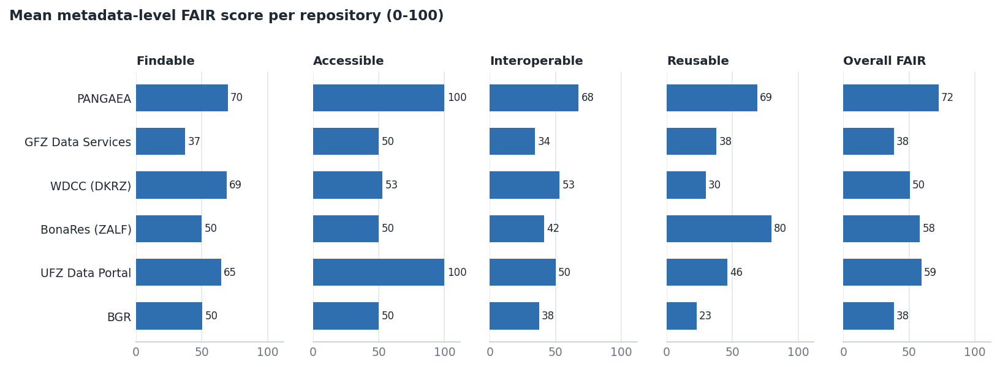

# How FAIR is the metadata of geoscience datasets in German repositories?

A small, fully reproducible pilot study: a random sample of dataset records from six
German Earth-system-science repositories is harvested from DataCite and checked against
18 transparent, metadata-level FAIR indicators. The outputs are one large assessment
table (datasets x indicators), summary tables, two figures and two "FAIR success stories".

**Main results** (300 records, harvested 16 Nov 2026): a record passes 53 % of the indicators on
average. DOIs, landing pages, formats and licences are widely present; temporal coverage (9 %),
provenance (13 %), funding references (20 %) and controlled-vocabulary keywords (31 %) are rare.
Differences between collections inside one repository can be larger than between repositories.
Details: [`docs/findings.md`](docs/findings.md) · [`docs/success_stories.md`](docs/success_stories.md) ·
[`results/summary.md`](results/summary.md)



## Workflow

```
config.yaml                      study design (repositories, sample size)
   |
01_harvest_datacite.py   ->  data/repositories.csv      repository name, re3data ID, size
                             data/sample_dois.csv       frozen DOI sample (study object)
                             data/raw/datacite_*.json   raw DataCite metadata
02_assess_metadata.py    ->  results/fair_assessment_table.csv   one row per dataset
03_run_fuji.py (optional)->  results/fuji_scores.csv             cross-check with F-UJI
04_analyse.py            ->  results/summary*.csv, indicator_pass_rates.csv,
                             success_story_candidates.csv, figures/, summary.md
```

## Run it

```bash
python3 -m venv .venv
.venv/bin/python -m pip install -r requirements.txt
.venv/bin/python run_all.py   # harvest -> assess -> analyse   (about 1-3 minutes)
.venv/bin/python -m pip install pytest && .venv/bin/python -m pytest tests   # unit tests
```

`data/sample_dois.csv` freezes the sample: re-running fetches the *same* DOIs again.
`python3 run_all.py --resample` draws a new random sample.

Optional cross-check with [F-UJI](https://github.com/pangaea-data-publisher/fuji) (needs Docker):

```bash
docker run -d -p 1071:1071 ghcr.io/pangaea-data-publisher/fuji
python3 scripts/03_run_fuji.py --per-repository 10 && python3 scripts/04_analyse.py
```

## Repositories

PANGAEA, GFZ Data Services, World Data Center for Climate (DKRZ), BonaRes (ZALF),
UFZ Data Investigation Portal and BGR — selected as German repositories for Earth and
environmental sciences that register dataset DOIs with DataCite. DataCite client IDs are
in `config.yaml`; re3data identifiers are read from the DataCite client records.

## Indicators

Each indicator is a yes/no test on the DataCite record (definitions in
[`fairgeo/indicators.py`](fairgeo/indicators.py)). The score per principle is the share of
its indicators passed; the overall score is the share of all 18 indicators passed
(every indicator has equal weight).

| Principle | Indicators |
|---|---|
| Findable | DOI findable · description >= 100 characters · keywords · creator PID (ORCID) · spatial coverage · temporal coverage |
| Accessible | https landing page · size declared |
| Interoperable | file format declared · keywords from a controlled vocabulary · links to related objects · affiliation PID (ROR) |
| Reusable | license stated · license machine-readable · open license · provenance information · funding reference · DataCite schema 4.x |

## Limitations (please read before quoting numbers)

- **Metadata only.** The indicators see what a repository registered at DataCite — not the
  landing page, the data files, or domain metadata (e.g. ISO 19115) that a repository may
  expose elsewhere. A low score means "not visible in DataCite", not "bad data".
- **Accessibility is barely visible in DataCite metadata.** It is mostly a property of the
  repository service (protocols, authentication, landing pages). Only two indicators could be
  defined, so read the "Accessible" score with caution. A planned "direct data link"
  indicator was dropped: no record in the sample exposed one, so it carried no information.
- **Random records, not curated highlights.** A repository's sample mirrors its DOI
  population. Large automatic collections (e.g. GEOFON earthquake event records at GFZ,
  35 of 50 sampled records) dominate the repository mean.
- **Not the official FAIRsFAIR/F-UJI metrics.** The indicators are inspired by them and are
  deliberately simple; scores are not comparable with F-UJI percentages.
- **Sampling.** 50 random records per repository: repository means carry sampling
  uncertainty (roughly +/- 14 percentage points for a pass rate near 50 %), and the pooled
  figures weight all repositories equally regardless of their size.
- **Automated FAIR assessment is a proxy.** It cannot judge scientific quality or whether
  metadata are *correct* — only whether they are present and machine-readable.

## Licence and citation

Code: MIT (`LICENSE`). Tables, figures and documents: CC BY 4.0. DataCite metadata are CC0.
Please cite via `CITATION.cff`. Research data management of this project: [`docs/DMP.md`](docs/DMP.md).

Developed with the support of an AI coding assistant (Claude); design decisions, checks and
interpretation are the author's responsibility.
