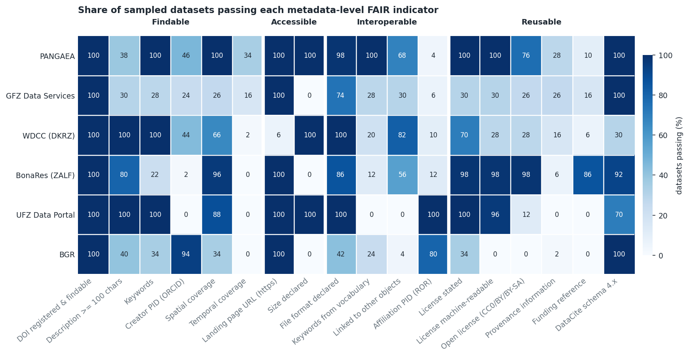

# Findings (pilot, harvest of 16 November 2026)

300 dataset records — a random sample of 50 from each of six German Earth-system-science
repositories — were checked against 18 metadata-level FAIR indicators. All numbers below come
from `results/` and can be regenerated with `run_all.py`. Please read the limitations in the
README: the study sees DataCite metadata only, and repository means from 50 records carry a
sampling uncertainty of up to about +/- 14 percentage points.

## 1. The basics are in place, the "machine-actionable" layer is not

- Every sampled record has a findable DOI; 84 % have an https landing page, 83 % declare a
  file format and 72 % state a licence.
- Much rarer: temporal coverage as a typed date (9 %), provenance information (13 %),
  funding references (20 %), keywords from a controlled vocabulary (31 %), creator
  identifiers such as ORCID (35 %) and affiliation identifiers such as ROR (35 %).
- On average a record passes 52.8 % of the indicators (range 22 - 100 %).

## 2. Repositories have clearly different profiles

| Repository | Mean share of indicators passed | Stands out for |
|---|---|---|
| PANGAEA | 72 % | keywords from vocabularies and spatial coverage in every record |
| UFZ Data Portal | 59 % | affiliation identifiers (ROR) in every record; no creator ORCIDs, no related identifiers |
| BonaRes (ZALF) | 58 % | open licences (98 %) and funding references (86 %) |
| WDCC (DKRZ) | 50 % | rich descriptions and links to related objects; many older records with http URLs and pre-4.x schema |
| GFZ Data Services | 38 % | see section 3 |
| BGR | 38 % | creator ORCIDs (94 %), but no machine-readable licence in any sampled record |

No repository is best everywhere, and almost every one leads on at least one indicator. That makes the
table useful as a list of "who can learn what from whom".

## 3. Collections matter more than repositories

35 of the 50 GFZ records are automatically registered GEOFON earthquake event records. They
pass 23 % of the indicators on average; the other 15 GFZ records pass 75 % — higher than
the PANGAEA average. A repository mean therefore says little without looking at the
collections behind it; a follow-up study should stratify the sample by collection or
resource type.

## 4. What I would do next

1. Cross-check a sub-sample with F-UJI (`scripts/03_run_fuji.py`), which also inspects landing pages.
2. Stratify by collection and publication year (are newer records better?).
3. Add a DOI-resolution test to strengthen the thin "Accessible" dimension.
